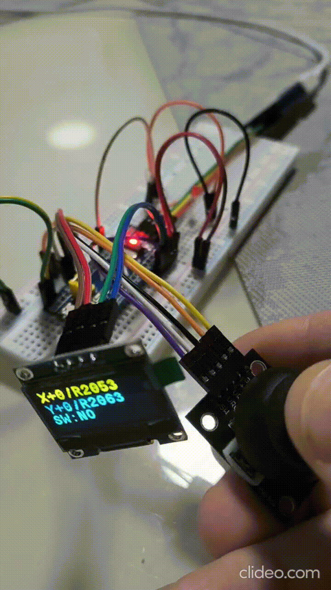

# learn-STM32

## `doom-nano`

Порт гри [doom-nano](https://github.com/daveruiz/doom-nano) (3D-рушій raycasting у стилі Wolfenstein 3D / Doom) з Arduino Nano на STM32F103C8. [CubeMX | CubeIDE | HAL | C]

* Картинка на OLED SSD1306 128x64 по I2C, керування аналоговим джойстиком, звук на пасивний бузер (PA1).
* Налаштування CubeMX взяті з проекту `flightStick_bluetooth`.
* Оригінальні файли гри — у [doom-nano/doom-nano-master](doom-nano/doom-nano-master), порт — у [doom-nano/doom-nano](doom-nano/doom-nano).
* Опис змін, розпіновка й керування — у [doom-nano/doom-nano/README.md](doom-nano/doom-nano/README.md).


## Bluetooth-проєкт

* Керування діодом через блютуз модуль HC-05. [CubeMX | CubeIDE | HAL | C]
* Програматор ST-LINK v2.
* HC-05 - відладка за допомогою STM32f103t6 модуля з прошивкою mimic_USB-TTL

**Основна стаття схеми**
Схему підключення можна знайти в статті
[Interfacing Bluetooth HC-05 with STM32F103C8 Blue Pill: Controlling LED](https://circuitdigest.com/comment/31928)


## `flightStick_bluetooth`

Проєкт джойстика на STM32F103: значення осей `X` та `Y` читаються через два ADC-канали з DMA, а натискання кнопки `SW` визначається через GPIO з антибрязкотом.

Розрахункові значення осей від `-100` до `100`, сирі ADC-значення та стан кнопки виводяться на OLED-дисплей SSD1306. При натисканні кнопки світлодіод на `PA1` увімкнеться.



### Схема підключення

| Джойстик / модуль | STM32F103C8 | Призначення |
|---|---|---|
| VRx | PB0 (`ADC1_IN8`) | вісь X |
| VRy | PB1 (`ADC1_IN9`) | вісь Y |
| SW | PB7 (`JOY_SW`) | натискання; внутрішня підтяжка ввімкнена |
| VCC | `3.3 V` | живлення джойстика |
| GND | `GND` | спільна земля |
| OLED SDA | PB9 (`I2C1_SDA`) | дані дисплея |
| OLED SCL | PB8 (`I2C1_SCL`) | синхронізація дисплея |
| OLED VCC | `3.3 V` | живлення дисплея |
| OLED GND | `GND` | спільна земля |
| Світлодіод `+` / A | PA1 через резистор `220-1k Ом` | індикатор натискання SW |
| Світлодіод `-` / K | GND | спільна земля |

```text
                Джойстик
           +----------------+
    3.3V---| VCC        VRx |---PB0/ADC1_IN8
     GND---| GND        VRy |---PB1/ADC1_IN9
           | SW            |
     GND---| SW             |
           +----------------+

                OLED SSD1306
    3.3V-------------------VCC
     GND-------------------GND
     PB9-------------------SDA
     PB8-------------------SCL

SW ----------------------------PB7
SW ----[натискання замикає]----GND

PA1 ----/\/\/\ 220-1k Ом---->|----GND
```

## `snakeGame`

Мінімальна гра «Змійка» на тій самій платформі, що й `flightStick_bluetooth`: джойстик (ADC + DMA) та OLED-дисплей SSD1306 по I2C. Проєкт створено як копію `flightStick_bluetooth`, тому схема підключення ідентична (див. таблицю вище).


### Гра

* Поле 32×13 клітинок по 4 px, зверху рядок з рахунком `Score` та рекордом `Best`.
* Змійка керується відхиленням стіка (поріг 50%); розвернутися «в себе» не можна.
* Зіткнення зі стіною або з власним хвостом завершує гру.
* З кожною з'їденою їжею змійка росте й прискорюється (крок від 250 до 80 мс), а світлодіод на `PA1` перемикається.
* Натискання стіка (`SW`) — старт / рестарт гри.
* Позиція їжі генерується ГВЧ, засіяним шумом АЦП та системним таймером.

### Структура

* `App/Src/joystick.c` — читання та фільтрація осей, антибрязкіт кнопки.
* `App/Src/snake.c` — логіка та відмальовка гри (`Snake_Init()`, `Snake_Process()`).
* `Core/Src/main.c` — ініціалізація периферії та головний цикл.

Напрямок осей налаштовується в `App/Src/snake.c` через `JOY_INVERT_X` / `JOY_INVERT_Y`.
